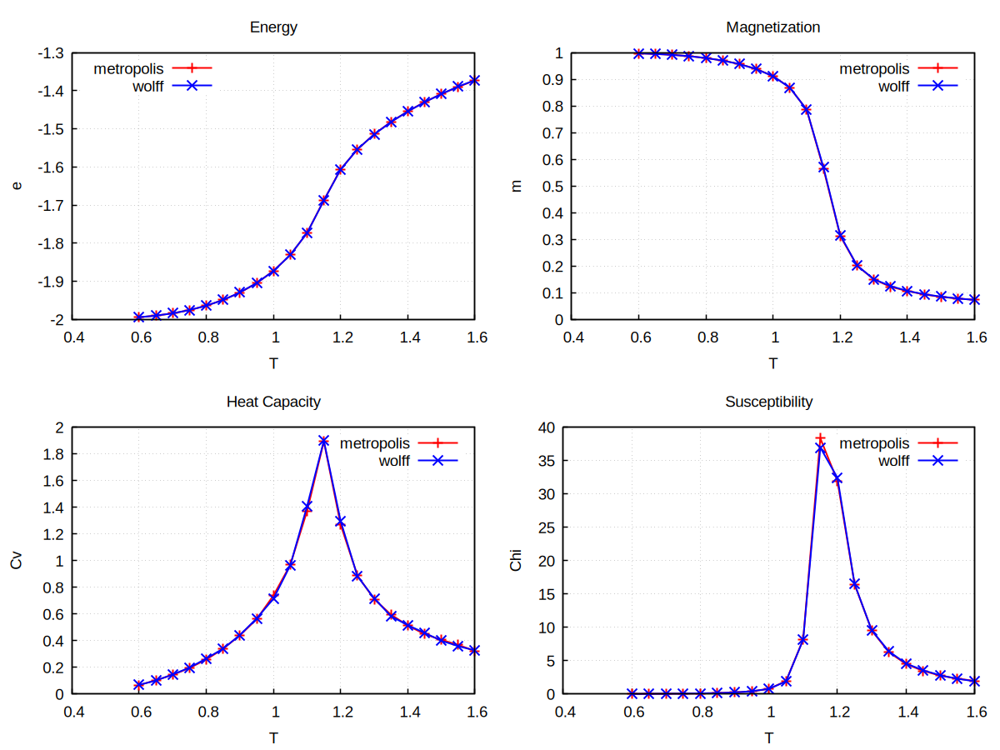

# Monte Carlo simulation of q state Potts model

`potts_MC_T.py` is a Python script to simulate Potts model with either single-flip Metropolis or Wolff cluster algorithm. One can manually set and change `q`, `L`, Monte Carlo move type and other parameters by editing it. To run it at temperature `T=0.85` 
```bash
python potts_MC_T.py 0.85
```
which will save the configuration snapshots as `.npy` file in current directory.

To run MC over a range of temperatures (in the background), use
```bash
./run_allMC.sh
```
which will send each `T` to each CPU so they can be run in parallel.

To calculate thermal quantities, e.g. energy, magnetization, heat capacity, susceptibility, using configurations at one temperature
```bash
python analysis.py configuration_path 0.650
```
To run over all temperatures, use the bash script (modify `configuration_path` inside yourself)
```bash
./analysis_all.sh
```
which save all results in `potts_thermal_q2L32.dat` (or name your own file)

gnuplot script `plot` make the plot by
```bash
gnuplot plot
```



